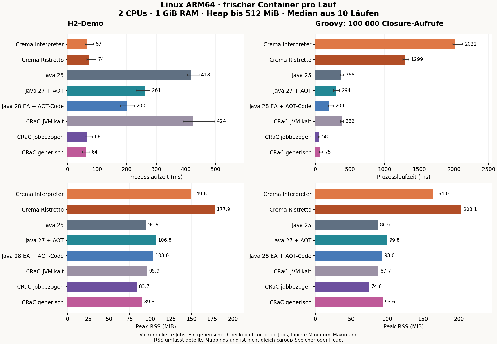
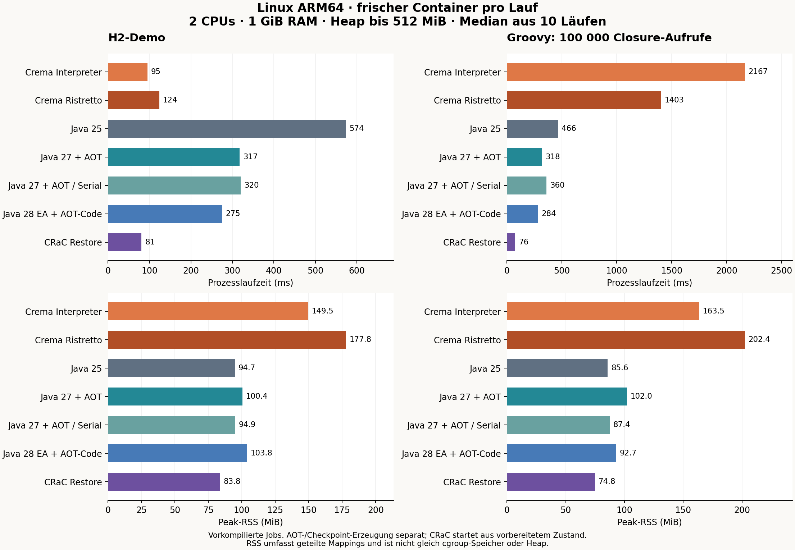

# Linux: Crema, aktuelle JVM, AOT und CRaC

Stand: 26. Oktober 2026. Alle unten genannten Zahlen wurden in dieser Reihe tatsächlich gemessen. Die früheren macOS-Ergebnisse stehen im [JVM-Vergleich](JVM-VERGLEICH.md).

Der neue Vergleich bestätigt: **Ein einziger generischer CRaC-Checkpoint kann wechselnde, erst danach kompilierte GRETL-Job-JARs und Parameter übernehmen.** Er benötigt hier 64 ms für H2 und 75 ms für die Groovy-Rechenprobe. Die konkreten Jobmethoden waren beim Checkpoint noch unbekannt. Der Nachtrag misst alle acht Vergleichsvarianten erneut; die ursprüngliche umfangreichere Reihe bleibt darunter erhalten.

## Nachtrag: generischer CRaC-Runner

### Aufbau und Abnahme

Der Bootstrap wärmt ausschliesslich einen festen synthetischen Job auf: Parameterauflösung, Groovy-Closures, Vorgängerresultate, `FileSize` sowie H2-SQL-Datei und Prepared Statement. Er führt drei Trainingsläufe mit jeweils 1000 einfachen Closure-Aufrufen aus, schliesst die Ressourcen, entfernt seine Trainingsdatenbanken und erzeugt einen Checkpoint. Er trainiert weder den H2-Demo-Job noch die Groovy-Rechenprobe mit ihren 100000 Aufrufen.

Bei der Vorbereitung überdeckt eine leere tmpfs das Demo-Verzeichnis `/app/jobs`; der Bootstrap prüft, dass dort keine Jobdateien sichtbar sind. **Erst nach dem Checkpoint** kompiliert ein separater Container die beiden Demo-JARs sowie einen dritten Testjob nach `/post-jobs`. Die Klassenbytes der beiden Demo-JARs stimmen mit denen der Vergleichsvarianten überein. Das dritte JAR verwendet absichtlich denselben Einstiegsklassennamen `job` wie das H2-Demo und eine andere Implementierung. Es bestätigt den Wechsel zwischen unterschiedlichen JARs zusätzlich zu unterschiedlichen Klassennamen.

Alle generischen Restores verwenden denselben Checkpoint unter `/generic-checkpoint/runtime`, schreibgeschützt eingebunden. Jobpfad, `--job-root`, `--db` und `--param` werden als neue Argumente an den vorhandenen GRETL-Einstieg übergeben. Dessen eigener `URLClassLoader` lädt das JAR nach dem Restore. Jeder Restore führt genau einen Job aus und beendet den Prozess. Der neue Main-Aufruf ist eine [dokumentierte CRaC-Funktion von Azul](https://docs.azul.com/crac/operational/restoring-new-arguments); der feste Runtime-Classpath bleibt erhalten. Der Checkpoint-Hash ist vor und nach Abnahme und Messung identisch:

```text
8905f06a13c530560fb2808fbb515f2ce9259fda561be4da7ad58acfceb9e58d
```

**14 funktionale Prüfungen bestehen:** Jahresparameter 2037/2038 jeweils mit unabhängiger JDBC-Kontrolle, drittes JAR mit Ergebnissen 42/91, neue Iterationszahl der Rechenprobe, ungültiger Parameter, fehlendes JAR, falscher CLI-Aufruf sowie geänderte, fehlende und fehlerhafte externe SQL-Datei. Der geänderte SQL-Inhalt wird ebenfalls unabhängig per JDBC bestätigt. Das sind echte Warp-Restores; kein Kaltstart-Fallback ist aktiviert.

### Neue Messreihe

Unveränderte Messregeln: Linux ARM64 in Docker Desktop, **2 CPUs / 1 GiB / kein zusätzlicher Swap**, Heap 32–512 MiB, neuer Container pro Ausführung, drei Vorläufe und zehn Messungen je Variante/Job, rotierende Reihenfolge. **160/160 Messläufe**, 48 zusätzliche Vorläufe, **16/16 Smoke-Läufe** und **8/8 separate JDBC-Prüfungen der Smoke-Datenbanken** bestehen. Kein OOM-Kill trat auf.

Alle acht Varianten verwenden in dieser Reihe dasselbe ergänzte Image `sha256:07233d187fe5259d7084d3cff18e2b82c8180797c69a79db284beee4d7e5f770`. Es erweitert das unveränderte Image der ersten Reihe nur um den generischen Bootstrap, Trainingsfixture und Prüfwerkzeuge. Die bisherigen Runtime-JARs, JDKs, nativen Binaries, AOT-Caches und jobbezogenen Checkpoints werden wiederverwendet. Der generische Checkpoint wurde neu erzeugt; die bisherigen Checkpoints wurden nicht überschrieben.

**Alle Zahlen dieser Vergleichstabelle stammen aus der neuen Reihe.** Mehrere Kontrollvarianten laufen diesmal schneller als in der ersten Reihe. Deshalb werden keine Beschleunigungsfaktoren aus alten und neuen Laufzeiten gemischt. Alle Varianten hier verwenden vorkompilierte Job-JARs; der generische Quellstart ist nicht Gegenstand dieses Nachtrags.



Zeit in ms: Median [Minimum–Maximum]. Speicher in MiB: Median der gemessenen Prozess-Peak-RSS-Werte. JVM-Start beziehungsweise Restore, gesamte Jobarbeit und Prozessende sind enthalten. Vorbereitung, Job-Kompilierung und Checkpoint-Erzeugung sind separat.

| Variante | H2 Zeit ms | H2 RSS MiB | Groovy Zeit ms | Groovy RSS MiB |
|---|---:|---:|---:|---:|
| Crema Interpreter | 67 [60–88] | 149.6 | 2022 [1984–2124] | 164.0 |
| Crema Ristretto | 74 [65–97] | 177.9 | 1299 [1263–1351] | 203.1 |
| Java 25 | 418 [405–445] | 94.9 | 368 [364–407] | 86.6 |
| Java 27 + AOT | 261 [232–279] | 106.8 | 294 [261–352] | 99.8 |
| Java 28 EA + AOT-Code | 200 [179–226] | 103.6 | 204 [192–261] | 93.0 |
| Azul CRaC-JVM kalt | 424 [391–498] | 95.9 | 386 [366–408] | 87.7 |
| CRaC jobbezogen | 68 [59–85] | 83.7 | 58 [49–65] | 74.6 |
| CRaC generisch | 64 [50–75] | 89.8 | 75 [61–109] | 93.6 |

Containerzeit in ms: Median vom Aufruf `docker create` bis zum Abschluss von `docker start --attach`. Speicher in MiB: Median der cgroup-Peaks. Diese Kennzahlen haben die weiter unten erläuterten Messgrenzen; insbesondere ist RSS nicht mit cgroup-Speicher gleichzusetzen.

| Variante | H2 Container ms | H2 cgroup MiB | Groovy Container ms | Groovy cgroup MiB |
|---|---:|---:|---:|---:|
| Crema Interpreter | 245 | 46.7 | 2192 | 68.6 |
| Crema Ristretto | 255 | 54.9 | 1455 | 74.3 |
| Java 25 | 584 | 80.9 | 512 | 72.7 |
| Java 27 + AOT | 416 | 88.2 | 439 | 82.6 |
| Java 28 EA + AOT-Code | 356 | 79.6 | 364 | 70.8 |
| Azul CRaC-JVM kalt | 573 | 82.2 | 533 | 73.7 |
| CRaC jobbezogen | 212 | 39.1 | 214 | 32.0 |
| CRaC generisch | 241 | 35.5 | 258 | 39.3 |

### Einordnung

- **Ein Checkpoint pro Job ist für diesen Runner nicht erforderlich.** Ein gemeinsamer Zustand wärmt genügend Runtime-Code auf, um beide unbekannten Demo-Jobs schnell auszuführen. Neue Job-JARs und Parameter verlangen keinen neuen Checkpoint; Änderungen an JDK, Runtime, Groovy, Taskkatalog oder anderen Checkpoint-Voraussetzungen müssen neu qualifiziert werden.
- **Bei H2 ist der generische Restore praktisch gleichauf mit dem jobbezogenen:** 64 gegenüber 68 ms, bei überlappenden Spannweiten. Das ist kein belastbarer Geschwindigkeitsvorteil des generischen Zustands. Unter Einbezug der Containerverwaltung liegt er mit 241 gegenüber 212 ms sogar dahinter; kleine Prozessdifferenzen erklären die gesamte Containerzeit nicht.
- **Bei der Rechenprobe kostet der generische Zustand rund 17 ms beziehungsweise 29 % Prozesslaufzeit:** 75 statt 58 ms. Er enthält keinen kompilierten Code dieses Jobs. Trotzdem beträgt die Laufzeit nur etwa ein Fünftel des kalten Starts derselben Azul-JVM (386 ms). Der gemeinsame Groovy-/Runner-Zustand liefert für diese Probe bereits einen grossen Teil des Nutzens.
- **Der Speicherpreis ist sichtbar:** generisch rund 90/94 MiB Peak-RSS statt 84/75 MiB für die beiden spezialisierten Restores. Der breiter trainierte Snapshot ist 73,8 MiB gross. Für beide Jobs zusammen ersetzt er die zwei Job-JAR-Checkpoints mit insgesamt 123,3 MiB. Das ist eine Artefaktgrössenbetrachtung; der gleichzeitige physische Speicherbedarf mehrerer Pods wurde nicht gemessen.
- **Die Vorbereitung bleibt vorab zu bezahlen:** 0,55 s für drei synthetische Trainingsläufe und Checkpoint bei 2 CPUs / 1 GiB; die Kompilierung der Trainingsfixture erfolgt vorher beim Image-Build. Diese eine Vorbereitungszeit fällt für den gemeinsamen Zustand an. Die ältere Vorbereitungszeit der spezialisierten Checkpoints wurde hier nicht erneut gemessen und wird damit nicht direkt verglichen.

Für euren Ablauf «Pod starten → wechselnden Job ausführen → Pod beenden» ist ein **gemeinsam vorbereiteter CRaC-Runner damit ein konkreter Kandidat**. Er verbindet freie Jobwahl mit kurzen Restore-Laufzeiten und vermeidet die Pflicht zur Checkpoint-Erzeugung pro Job. Die beiden Jobs belegen diese Architektur für den vorhandenen minimalen Taskkatalog, nicht die Verträglichkeit aller GRETL-Erweiterungen. Neue Jobmethoden müssen weiterhin geladen und bei Bedarf JIT-kompiliert werden; beliebige Jobs werden deshalb nicht automatisch so schnell wie diese beiden. OpenShift-Scheduling, Image-Pull, kalte Node-Caches und Ausführung unter einer zufälligen UID bleiben ausserhalb dieses Docker-Versuchs.

### Reproduktion und Nachweise

Voraussetzung sind das ursprüngliche Linux-Image und seine nativen/AOT-/CRaC-Artefakte. Das neue Buildskript erstellt genau einen generischen Checkpoint und kompiliert die Messjobs danach. Seine Docker-Volumes heissen `gretl-crema-linux-generic-checkpoint` und `gretl-crema-linux-generic-jobs`.

```bash
./scripts/build-generic-crac.sh
python3 scripts/benchmark-linux.py smoke --suite generic
python3 scripts/validate-linux-databases.py --suite generic
python3 scripts/benchmark-linux.py measure --suite generic
python3 scripts/collect-linux-metadata.py --suite generic
python3 scripts/archive-linux.py --suite generic
# Mit Matplotlib 3.9.4:
python3 scripts/plot-linux.py --suite generic
```

Ergebnisse: [160 Rohmessungen](results/linux-generic-runs.json), [14 funktionale Prüfungen](results/linux-generic-validation.json), [16 Smoke-Läufe](results/linux-generic-smoke.json), [8 JDBC-Prüfungen](results/linux-generic-databases.json), [Vorbereitung](results/linux-generic-preparation.json), [danach kompilierte Jobklassen](results/linux-generic-jobs.json), [Runtime-Identitäten und Checkpoint-Hash nach der Messung](results/linux-generic-environment.json). Die Testjobs liegen ausserhalb des JVM-Classpaths. Ohne neue Main-/Jobargumente bricht der Bootstrap nach dem Restore ab und führt keinen gespeicherten Trainingsjob aus.

## Erste Messreihe: jobbezogene Checkpoints und JVM-Varianten

Die folgenden Abschnitte dokumentieren die ursprüngliche Messreihe. Dort wurden vier spezialisierte Checkpoints pro Job und Startform vorbereitet; der neue generische Nachweis steht oben.



## Versuchsaufbau

- Linux ARM64 (`aarch64`), Kernel `7.0.14-linuxkit`, Docker Desktop auf Apple M5; Docker Engine 29.8.1. Die Docker-VM hat sechs CPUs und rund 12 GiB RAM. Es lief keine weitere Benchmark- oder Native-Build-Reihe gleichzeitig; fremde Container wurden nicht angehalten.
- **Jede Ausführung erhält einen neuen Container:** `--cpus=2 --memory=1g --memory-swap=1g --pids-limit=512 --network=none`. Der CPU-Wert ist eine Quote von zwei CPUs, keine exklusive Bindung an zwei Kerne. Kein zusätzlicher Swap; Java und Native verwenden `-Xms32m -Xmx512m`. CRaC übernimmt diese Heap-Einstellungen aus dem Checkpoint.
- Beide Jobs und alle Varianten laufen im selben vorbereiteten Image. Gemessene Image-ID: `sha256:6f3dafc4ebcf2193349ae1c04989f4d2947a32d05caa7a01bb81bc52bdbe04de`. Native Binaries wurden unter Linux gebaut. Die Image-/Runtime-Identitäten und Artefakt-Hashes sind [archiviert](results/linux-environment.json).
- **20 Varianten × 2 Jobs × 10 Messungen = 400 Messläufe**, zusätzlich je drei Vorläufe, also insgesamt **520 frische Container**. Die Variantenreihenfolge rotiert pro Runde. Vorläufe wärmen Dateicaches; normale Prozesse übernehmen keinen JIT-Code von früheren Prozessen. AOT und CRaC übernehmen absichtlich ihren vorbereiteten Zustand.
- H2: externe SQL-Datei lesen, Tabelle anlegen/leeren, 17-Byte-Fixture messen, Parameter `jahr=2026` und Ergebnis über Prepared Statement schreiben. Pro Container eine neue lokale Datenbank. Groovy: derselbe dynamische Job mit **100000 Closure-Aufrufen**, Prüfergebnis `HOTLOOP_OK 326690737`, ohne `@CompileStatic`.
- Job-JAR und Groovy-Quellstart sind getrennte Messvarianten. Beim Quellstart ist die Groovy-Kompilierung im jeweiligen Lauf enthalten. Bei einem Job-JAR findet sie vorher statt.
- Die Benchmarks laufen mit dem Standardbenutzer des Images, also root. CRaC benötigte weder `--privileged` noch zusätzliche Capabilities. OpenShift mit zufälliger unprivilegierter UID wurde hier nicht geprüft. Die zusätzlichen Maven-Berechtigungstests laufen ausdrücklich als `nobody`.

**Der JVM-Start ist enthalten.** Die Prozessuhr startet unmittelbar vor dem Erzeugen des Java-/Native-Prozesses und endet nach dessen Abschluss. Das umfasst JVM-Start, Klassenladen, JIT-Anlauf, die gesamte Jobarbeit und Prozessende. Bei CRaC umfasst sie Start der Restore-JVM, Restore, die danach vollständig ausgeführte Jobarbeit und Prozessende; die frühere Checkpoint-Erzeugung wird separat ausgewiesen.

Zusätzlich wird die Zeit vor `docker create` bis nach `docker start --attach` gemessen. Diese umfasst Containererstellung und Start-/Attach-Verwaltung, aber weder das spätere `docker rm` noch Scheduling, Image-Pull oder vollständigen Podabbau. Die Images sind bereits lokal vorhanden. Ein neuer Container bedeutet hier keinen kalten Linux-Dateicache und keinen kalten Kubernetes-Node.

## Runtimes und untersuchte Einstellungen

| Variante | Tatsächliche Runtime / Einstellung |
|---|---|
| Crema Interpreter / Ristretto | Oracle GraalVM 25.4.4.1.1, JDK 25.0.4.1.1; `RuntimeClassLoading`, zusätzlich beim JIT `GraalJITCompileAtRuntime` |
| Java 25 | Temurin HotSpot 25.0.4.1+1, Standard-C1/C2; unter diesen Limits automatisch Serial GC |
| Java 27 | Oracle HotSpot 27.0.1.0.3+1-2, hier aktuelle stabile Version; automatisch G1 und kompakte Objekt-Header |
| Java 27 + AOT | Pro Job trainierter Klassen-/Objekt-/Profilcache; Verwendung mit `AOTMode=required` |
| Java 27 + AOT / Serial | Zusätzlicher eigener Cache und `-XX:+UseSerialGC` |
| Java 27 + AOT / eager | Zusätzlicher eigener Cache, `UnlockExperimentalVMOptions` und `AOTCompileEagerly` |
| Java 28 EA | OpenJDK 28-ea+21-1707; separat ohne/mit AOT-Maschinencode |
| CRaC kalt / Restore | Azul Zulu 25.36+205-CRaC, JDK 25.0.4.1+1, echte Linux-Warp-Engine |

Downloads und SHA-256 stehen in [runtimes.json](../docker/runtimes.json). Sie liegen lokal unter `.tools/linux/`; SDKMAN und das Standard-JDK wurden nicht umgestellt. Bewegliche `latest`-URLs sind durch die erwartete Prüfsumme abgesichert: Ein anderes Archiv muss ausdrücklich neu qualifiziert werden.

Java 27 AOT und Java 28 AOT sind technisch unterschiedlich. Unter Java 27 werden Klassen, Objekte und Methodenprofile vorbereitet; der HotSpot-JIT arbeitet im Lauf weiter. Die Methodenprofile gehören zur AOT-Entwicklung seit [JEP 515](https://openjdk.org/jeps/515). Java 28 EA ergänzt vorab erzeugten Maschinencode durch [JEP 544](https://openjdk.org/jeps/544). Der separate Diagnoselauf bestätigt **2596 geladene AOT-Code-Einträge**. Ristretto installiert seinerseits Code für die beiden dynamischen Groovy-Closure-Methoden der Rechenprobe. Die [Diagnoselogs](results/linux-diagnostics.log) sind ausserhalb der Zeitmessung entstanden. Java 28 bleibt eine [Early-Access-Version](https://jdk.java.net/28/).

`AOTMode=required` verhindert einen stillen Lauf ohne verwendbaren Cache; die Bedeutung dokumentiert das [Java-27-Handbuch](https://docs.oracle.com/en/java/javase/27/docs/specs/man/java.html). Es wurden die oben genannten Einstellungen geprüft, keine vollständige Suche über alle JVM-Flags. Die unterschiedlichen Anbieter und automatisch gewählten GCs sind Teil des Vergleichs; die Java-Version allein erklärt deshalb keine Differenz.

## Ergebnisse: vorkompilierte Job-JARs

Zeit in Millisekunden: **Median [Minimum–Maximum]** aus zehn frischen Prozessen. Speicher: Median der zehn Peak-RSS-Werte in MiB. Die Einzelwerte einschliesslich CPU-Zeit und vollständiger Befehle stehen in [linux-runs.json](results/linux-runs.json).

| Variante | H2 Zeit ms | H2 RSS MiB | Groovy Zeit ms | Groovy RSS MiB |
|---|---:|---:|---:|---:|
| Crema Interpreter | 95 [78–151] | 149.5 | 2167 [2077–2306] | 163.5 |
| Crema Ristretto | 124 [102–207] | 177.8 | 1403 [1279–1663] | 202.4 |
| Java 25 | 574 [481–674] | 94.7 | 466 [418–628] | 85.6 |
| Java 27 | 517 [436–591] | 124.1 | 505 [436–541] | 107.2 |
| Java 27 + AOT | 317 [281–475] | 100.4 | 318 [271–374] | 102.0 |
| Java 27 + AOT / Serial | 320 [286–506] | 94.9 | 360 [313–432] | 87.4 |
| Java 27 + AOT / eager | 356 [306–455] | 107.2 | 387 [350–451] | 100.4 |
| CRaC kalt | 516 [439–709] | 95.4 | 500 [426–599] | 87.8 |
| CRaC Restore | 81 [66–108] | 83.8 | 76 [69–84] | 74.8 |
| Java 28 EA | 584 [501–760] | 116.4 | 584 [519–723] | 99.6 |
| Java 28 EA + AOT-Code | 275 [229–391] | 103.8 | 284 [221–382] | 92.7 |

## Ergebnisse: Groovy-Quellstart

Gleiche Einheiten und Messgrenzen. Diese Varianten kompilieren das Skript im jeweiligen Lauf. Beim CRaC-Quellstart wird nach dem Restore erneut der Quellladepfad aufgerufen; der Zustand von Compiler und JVM wurde davor trainiert.

| Variante | H2 Zeit ms | H2 RSS MiB | Groovy Zeit ms | Groovy RSS MiB |
|---|---:|---:|---:|---:|
| Java 25 / Quelle | 780 [663–874] | 114.1 | 790 [733–927] | 106.8 |
| Java 27 / Quelle | 747 [683–893] | 176.0 | 743 [670–878] | 166.6 |
| Java 27 + AOT / Quelle | 481 [388–608] | 131.2 | 500 [466–544] | 131.3 |
| Java 27 + AOT / Serial / Quelle | 468 [399–819] | 104.2 | 522 [456–596] | 95.3 |
| Java 27 + AOT / eager / Quelle | 530 [430–619] | 131.5 | 562 [476–623] | 137.8 |
| CRaC kalt / Quelle | 733 [691–908] | 112.7 | 767 [672–854] | 107.0 |
| CRaC Restore / Quelle | 106 [85–147] | 98.7 | 115 [96–140] | 97.3 |
| Java 28 EA / Quelle | 768 [705–955] | 173.9 | 825 [714–1658] | 156.8 |
| Java 28 EA + AOT-Code / Quelle | 420 [362–515] | 144.8 | 494 [382–560] | 144.1 |

## Containerzeit und cgroup-Speicher

Alle Werte sind Mediane. Containerzeit: `docker create` bis Ende des Start-/Attach-Aufrufs, in Millisekunden. cgroup-Peak: `memory.peak` in MiB.

| Variante | H2 Container ms | H2 cgroup MiB | Groovy Container ms | Groovy cgroup MiB |
|---|---:|---:|---:|---:|
| Crema Interpreter | 278 | 46.5 | 2341 | 68.0 |
| Crema Ristretto | 321 | 54.9 | 1556 | 73.4 |
| Java 25 | 762 | 80.3 | 632 | 71.5 |
| Java 25 / Quelle | 945 | 99.8 | 971 | 92.4 |
| Java 27 | 695 | 109.6 | 679 | 92.6 |
| Java 27 / Quelle | 909 | 161.8 | 913 | 152.4 |
| Java 27 + AOT | 503 | 82.7 | 481 | 84.2 |
| Java 27 + AOT / Quelle | 656 | 110.7 | 693 | 112.1 |
| Java 27 + AOT / Serial | 503 | 77.5 | 547 | 71.0 |
| Java 27 + AOT / Serial / Quelle | 646 | 85.3 | 717 | 77.7 |
| Java 27 + AOT / eager | 539 | 88.7 | 557 | 83.7 |
| Java 27 + AOT / eager / Quelle | 715 | 110.6 | 746 | 118.6 |
| CRaC kalt | 711 | 81.5 | 680 | 74.1 |
| CRaC kalt / Quelle | 897 | 99.2 | 936 | 92.9 |
| CRaC Restore | 263 | 39.0 | 247 | 31.8 |
| CRaC Restore / Quelle | 307 | 43.5 | 330 | 47.0 |
| Java 28 EA | 779 | 100.5 | 834 | 83.9 |
| Java 28 EA / Quelle | 931 | 158.3 | 1014 | 141.2 |
| Java 28 EA + AOT-Code | 456 | 79.8 | 485 | 70.6 |
| Java 28 EA + AOT-Code / Quelle | 627 | 116.5 | 696 | 117.6 |

Der Verwaltungsanteil des Containers liegt bei diesen kleinen Jobs häufig in der Grössenordnung von 0,17–0,20 Sekunden. Er verkleinert den relativen Vorteil einer schnelleren Runtime. Beispielsweise sinkt beim H2-Job Java 25 → Interpreter die Prozesszeit von 574 auf 95 ms, die Zeit einschliesslich Containererstellung aber von 762 auf 278 ms. Java 28 AOT liegt bei der Rechenprobe im Prozessmedian vor Java 27 AOT, bei der Containerzeit sind die beiden praktisch gleichauf.

**RSS, Heap und cgroup-Peak messen unterschiedliche Dinge.** Linux `getrusage(RUSAGE_CHILDREN).ru_maxrss` liefert den Peak des gemessenen Java-/Native-Prozesses einschliesslich residenter geteilter Bibliotheks- und Dateimappings. Der Heap ist nur ein Teil davon. `memory.peak` umfasst dagegen dem Container zugerechnete Seiten, unter anderem auch den kleinen Python-Beobachter und Dateicache. Bereits vorhandene gemeinsame Dateiseiten können einer anderen cgroup zugerechnet sein. Dadurch kann RSS grösser als der hier gemessene cgroup-Peak sein. Es wurde kein PSS und keine zusätzliche physische Node-Speichernutzung gemessen.

Die nativen Varianten haben in dieser Reihe höhere RSS-Werte als Java 25, gleichzeitig niedrigere cgroup-Peaks. Daraus folgt kein allgemeiner Speichersparfaktor für native Pods. Insbesondere gemeinsame Code-/Checkpoint-Seiten im warmen Docker-VM-Dateicache dürfen nicht als garantierter Vorteil bei kalten, verteilten Cluster-Nodes verstanden werden. Die cgroup-Zahlen beschreiben die tatsächliche Belastung der gemessenen Container unter diesen Bedingungen; für Memory-Limits im Cluster muss dieselbe Belastung dort erneut beobachtet werden.

## Vorbereitung, Grössen und CRaC-Nachweis

Native-Build: Interpreter **374 s**, Binary **193,4 MiB**; Ristretto **484 s**, Binary **234,8 MiB**. Dazu kommen je rund **4,1 MiB** native Begleitbibliotheken und die weiterhin benötigten GraalVM-JDK-Dateien. Build-Limit: 4 CPUs / 8 GiB. Der gemeinsame Runner wurde je Variante einmal gebaut und danach für beide externen Job-JARs verwendet.

Die folgende Vorbereitung wurde **nicht** zur einzelnen Joblaufzeit addiert. Sie muss für die hier verwendeten jobbezogenen Artefakte an anderer Stelle bezahlt und bei Änderungen passend wiederholt werden. Die vier CRaC-Checkpoints dieser ersten Reihe gehören jeweils zu einem Job und einer Startform. Die Wiederverwendung eines einzigen generischen Checkpoints wurde anschliessend im Nachtrag oben nachgewiesen.

| Artefakt / Job | JAR: Vorbereitung s / MiB | Quelle: Vorbereitung s / MiB |
|---|---:|---:|
| Java 27 AOT / H2 | 4.21 / 34.0 | 5.22 / 42.4 |
| Java 27 AOT / Groovy | 4.45 / 27.2 | 5.16 / 35.9 |
| Java 27 AOT / Serial / H2 | 4.05 / 33.9 | 5.36 / 42.3 |
| Java 27 AOT / Serial / Groovy | 3.51 / 27.2 | 4.84 / 35.8 |
| Java 27 AOT / eager / H2 | 4.01 / 34.1 | 5.20 / 42.4 |
| Java 27 AOT / eager / Groovy | 3.48 / 27.4 | 4.38 / 35.9 |
| Java 28 EA AOT-Code / H2 | 2.46 / 40.6 | 3.47 / 51.7 |
| Java 28 EA AOT-Code / Groovy | 1.84 / 33.2 | 2.83 / 44.7 |
| CRaC Checkpoint / H2 | 1.91 / 67.1 | 2.36 / 79.6 |
| CRaC Checkpoint / Groovy | 1.37 / 56.2 | 3.22 / 75.1 |

Die CRaC-Vorbereitungszeit enthält drei vollständige Trainingsjobs, anschliessend `System.gc()` und den Checkpoint. Der Adapter [CracLauncher.java](../docker/CracLauncher.java) markiert den Checkpoint **vor** dem gemessenen Job. Der Restore druckt `CRAC_RESTORE_OK` und führt danach den vollständigen Job mit einer neuen `/work/measured-db` aus. Die Datenbank wurde unabhängig geprüft. Ein gespeichertes Fertigergebnis oder ein simulierter Checkpoint zählt hier nicht als Restore-Nachweis. Die kalten Kontrollläufe nutzen dieselbe Azul-JVM und denselben Adapter.

Das ist ein relevanter Unterschied zum Kaltstart: Ein CRaC-Container ist frisch, seine JVM startet aber aus einem trainierten Snapshot. Auch der JIT-Zustand kann so wiederverwendet werden. Die niedrigen Restore-Zeiten sind deshalb kein Beleg, dass ein gewöhnlicher frischer JVM-Kaltstart inzwischen nur 76 ms benötigt. Die [Azul-Dokumentation](https://docs.azul.com/crac/usage/running-crac) beschreibt die Anforderungen an passende Checkpoint-/Restore-Umgebungen; für Docker wird [Warp dokumentiert](https://docs.azul.com/crac/deployment/docker-container.html). Für weitere GRETL-Provider wären offene Verbindungen, Dateien und andere Ressourcen gesondert zu prüfen; dieser Versuch nutzt nur die beiden beschriebenen Jobs.

Die Java-27-Caches und CRaC-Checkpoints konnten mit 2 CPUs / 1 GiB erzeugt werden. Bei Java 28 scheiterte die Cache-Erzeugung für den Groovy-Quellstart reproduzierbar am 1-GiB-Limit: Exit 137, `oom_kill=1`, Peak genau 1073741824 Byte. [Fehlernachweis](results/linux-aot-build-oom.json). Daraufhin wurden ausschliesslich die ungemessenen Java-28-Cache-Builds mit **2 GiB** wiederholt. **Alle 400 gemessenen Ausführungen blieben bei 1 GiB** und hatten keinen OOM-Kill.

## Schlüsse für «Pod starten → Job ausführen → Pod beenden»

1. **Für kurze Jobs mit wenig Groovy-Arbeit bleibt Crema interessant.** Beim H2-Demo braucht der Interpreter 95 statt 574 ms unter Java 25. Ristretto bringt hier zusätzliche Anlaufkosten: 124 ms und mehr RSS. Das sagt noch nichts über lange SQL- oder ETL-Operationen aus.
2. **Für dynamische Groovy-Rechenarbeit ist HotSpot hier klar besser.** Ristretto senkt die Interpreterzeit von 2167 auf 1403 ms, bleibt aber langsamer als Java 25 mit 466 ms oder Java 27 AOT mit 318 ms. Die zusätzliche Laufzeitkompilierung amortisiert sich in dieser kurzen Rechenprobe nur teilweise.
3. **Java 27 mit AOT ist der nächste naheliegende JVM-Kandidat.** Gegenüber demselben Java 27 ohne Cache sinkt die Job-JAR-Zeit um rund 39 % bei H2 und 37 % bei der Rechenprobe. Die Runtime startet weiter pro Job frisch. Es wäre sinnvoll, das beim Verpacken der realen, häufig wiederholten Jobs im Cluster zu prüfen. Wie gut ein gemeinsamer Cache wechselnde nachgeladene Jobklassen abdeckt, wurde hier nicht getestet.
4. **Mehr Optionen ergeben keine durchgehende Verbesserung.** Serial GC reduziert mit AOT den RSS, kostet bei der Rechenprobe aber Laufzeit. `AOTCompileEagerly` ist hier langsamer als die gewöhnliche AOT-Variante. Das neuere Java allein gewinnt ebenfalls nicht überall. Kleine Unterschiede innerhalb der gezeigten Spannweiten rechtfertigen keine belastbare Rangfolge.
5. **Java 28 AOT-Maschinencode ist vielversprechend, aber EA.** Gegenüber Java 28 ohne Cache sinken die Job-JAR-Zeiten etwa um die Hälfte. Die Messung zeigt den technischen Nutzen; für eine Produktionsentscheidung sollte eine freigegebene Version mit den echten Jobs geprüft werden. Die Cache-Erzeugung kann mehr Speicher brauchen als die spätere Ausführung.
6. **CRaC ist für häufig wiederholte, bekannte Jobs besonders interessant.** Nach vorbereiteter Aufwärmung erreicht es 81 ms bei H2 und 76 ms bei der Rechenprobe, bei 84 beziehungsweise 75 MiB Peak-RSS. Beim H2-Job liegt es angesichts der Streuung in derselben schnellen Grössenordnung wie der Interpreter; bei der Rechenprobe ist der Vorteil gross. Das spart pro Ausführung Start-/Aufwärmarbeit, verschiebt sie aber in die Vorbereitung und verlangt ein passendes Checkpoint-Lebenszyklusmodell. Für seltene oder ständig veränderte Jobs kann dessen Aufwand den Nutzen aufzehren.

Diese Reihe rechtfertigt deshalb einen Cluster-Vergleich von normaler JVM mit AOT und einem bewusst vorbereiteten CRaC-Job. Für sehr kleine DSL-Jobs bleibt der Crema-Interpreter eine dritte Option. Einen Wechsel des gesamten GRETL-Taskkatalogs oder eine generelle Aussage über OpenShift-Kosten leiten diese zwei lokalen Jobs nicht her.

## Prüfstatus und Reproduktion

Erfolgreich: **400/400 Messläufe**, **40/40 Smoke-Fälle**, **20/20 unabhängige H2-Prüfungen**, **20/20 vorbereitete AOT-/Checkpoint-Artefakte**. Unter Java 25, Java 27 und Java 28 EA bestehen jeweils **204 Maven-Tests ohne Fehler oder übersprungene Tests**. Der Berechtigungstest läuft als unprivilegierter Benutzer; die Produktionsquellen wurden dafür nicht angepasst. Das gemessene Image blieb unverändert.

```bash
./mvnw verify
./scripts/build-linux.sh
python3 scripts/benchmark-linux.py prepare --kinds jdk27_aot,jdk27_aotserial,jdk27_eager,crac
python3 scripts/benchmark-linux.py prepare --kinds jdk28_aot --preparation-memory 2g
python3 scripts/benchmark-linux.py smoke
python3 scripts/validate-linux-databases.py
python3 scripts/benchmark-linux.py measure
./scripts/verify-linux-jvms.sh
python3 scripts/archive-linux.py
```

Die Artefakte bleiben in den Docker-Volumes `gretl-crema-linux-artifacts`, `gretl-crema-linux-aot` und `gretl-crema-linux-checkpoints`. Erneute Vorbereitung ersetzt passende Artefakte; zur Auswertung einer bestehenden Reihe die archivierten Dateien verwenden. Die unabhängigen Datenbankprüfungen und Maven-Läufe finden ausserhalb der Zeitmessung statt. Plot: `scripts/plot-linux.py` mit Matplotlib 3.9.4; PNG und SVG liegen unter `docs/results/`.

Weitere Nachweise: [Smoke-Läufe](results/linux-smoke.json), [JDBC-Prüfung](results/linux-databases.json), [Vorbereitung inklusive Befehlen und Logs](results/linux-preparation.json), [Maven-Teststatus](results/linux-tests.json). Die Rohdaten enthalten zusätzlich Prozess-CPU-Zeiten, Docker-Start-/Containerzeiten, cgroup-Ereignisse und die tatsächlich angewendeten Limits.

Nicht gemessen wurden Image-Pull, OpenShift-Scheduling, Storage über Netzwerk, kalte Node-Caches, konkurrierende produktive Last und vollständiger Podabbau. Das gemeinsame grosse Image enthält alle Test-JDKs und dient der Vergleichbarkeit; seine Grösse ist kein Vergleich optimierter Produktionsimages. Alle Ergebnisse gelten für Linux ARM64 auf diesem Host. Das Nachbarrepo `../gretl-runtime` wurde für diese Arbeiten nicht verändert.
